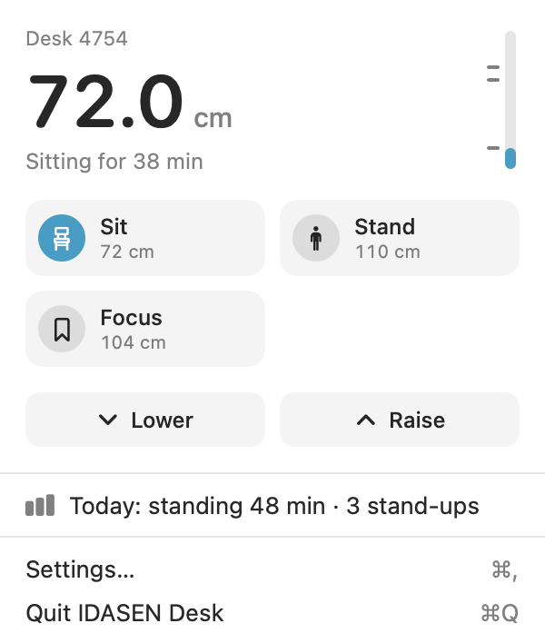
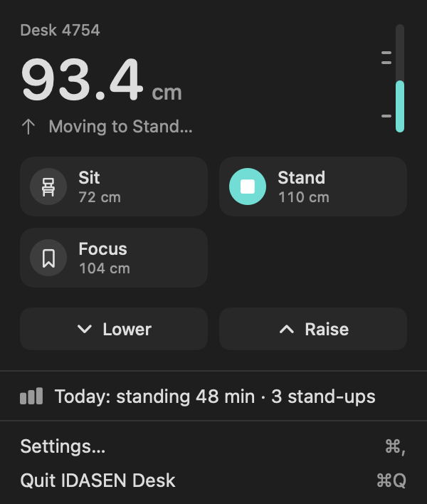
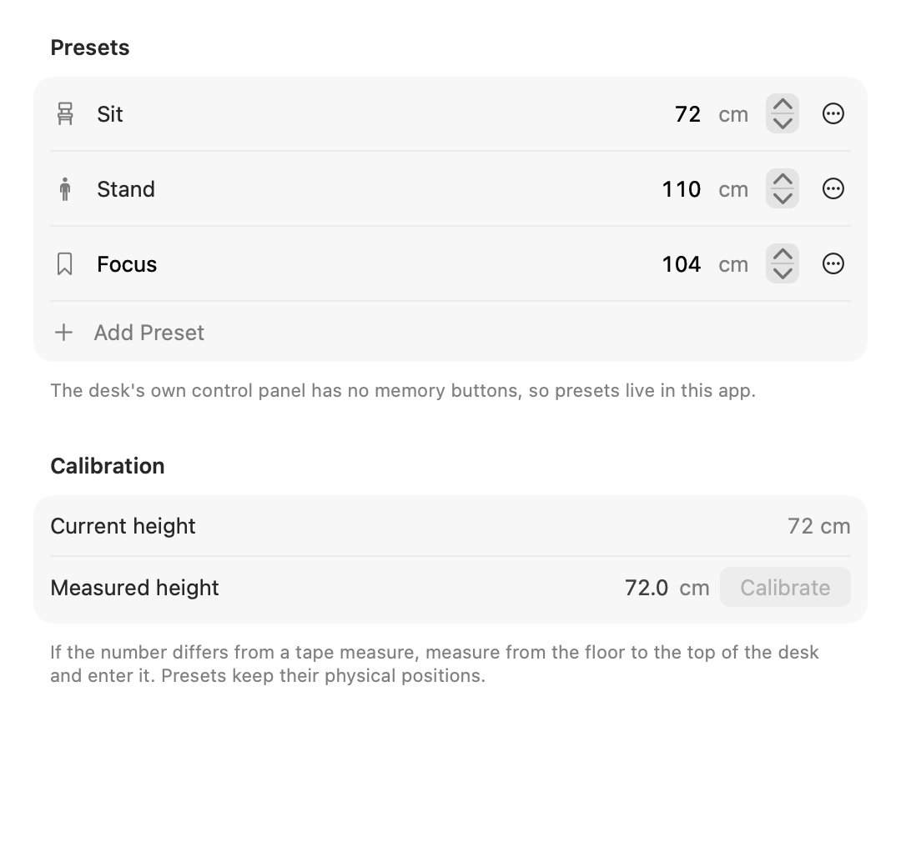
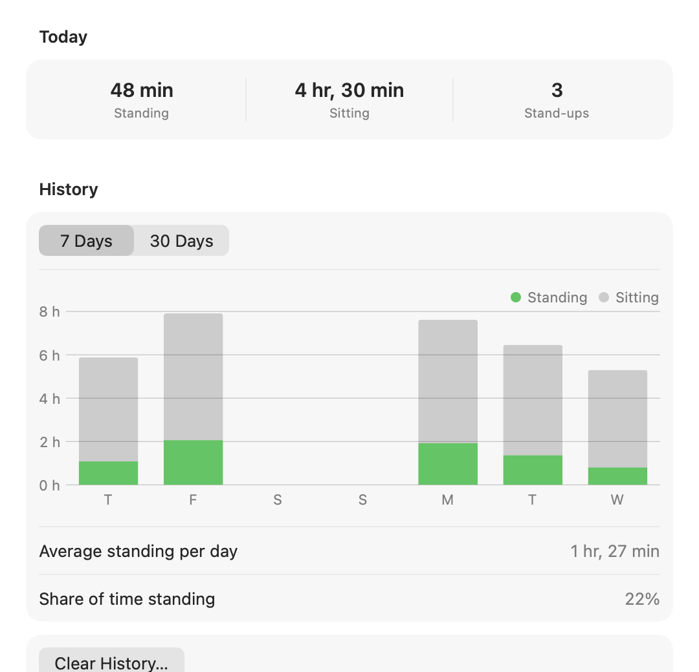
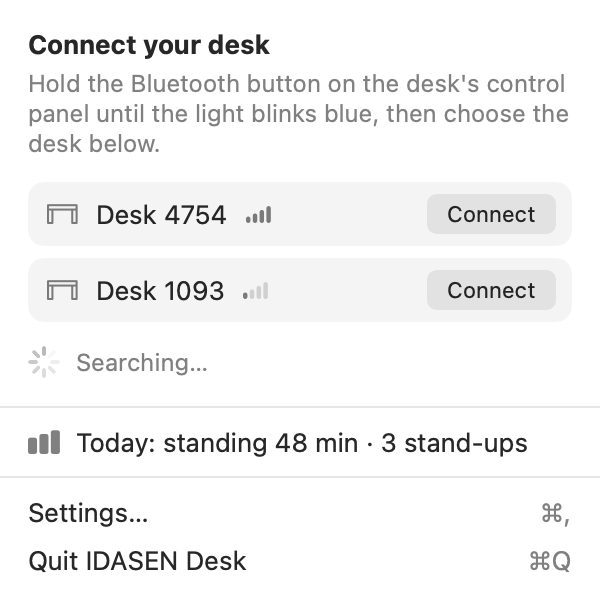

# IDASEN Desk

A native macOS menu bar app for IKEA IDASEN sit/stand desks.

Click Sit or Stand and the desk drives itself there, with the controller's own smooth start and stop. Get a gentle nudge when you've been sitting too long. See how much you actually stood this week.

Not affiliated with IKEA or Linak.

<p>
  
  
</p>

## Features

- **One-click presets.** Sit, Stand, and up to four named presets of your own. Moves use the desk controller's reference input, so the desk eases in and stops on the millimetre instead of being stopped by the app.
- **Hold to move.** Raise and Lower behave like the handle on the desk.
- **Stays connected.** Reconnects on its own after sleep, Bluetooth restarts, or when you carry your Mac between a home desk and an office desk.
- **Posture reminders.** Based on how long you've actually been sitting (measured from the desk height), not the clock. Time away from the Mac counts as a break. Reminders arrive as notifications with a Stand Up button, and never move the desk by themselves.
- **Activity history.** Standing and sitting time per day, stand-ups, and trends, counted only while you're at your Mac.
- **Global keyboard shortcuts** for Sit, Stand and Toggle.
- **Shortcuts and Siri:** Stand Up, Sit Down, Toggle Sit/Stand, Move Desk to Height, Get Desk Height.
- **Desk handle double tap** (optional): two quick taps up go to standing height, two down go to sitting height.
- **Calibration:** enter what a tape measure says, and every number in the app matches reality.
- **AppleScript** for older automations.
- English, 简体中文, 繁體中文, 日本語.

<p>
  
  
</p>

## The Important Limitation

The IDASEN control panel has no memory buttons, and the app can't add any. Presets, reminders, shortcuts and the double tap all need the app to be running and connected. When it isn't, the desk is a normal IDASEN desk.

## Requirements

- macOS 14 Sonoma or newer, Apple silicon or Intel.
- An IKEA IDASEN desk (Linak DPG controller with Bluetooth).

## Getting Started

1. Launch the app. It lives in the menu bar.
2. Hold the Bluetooth button on the desk's control panel until the light blinks blue.
3. Choose your desk in the menu and click Connect. macOS may ask to pair the first time.

From then on it connects by itself.



## Build From Source

Requires Xcode 16 or newer.

```sh
open "IDASEN Desk.xcodeproj"
```

From Terminal:

```sh
xcodebuild -project "IDASEN Desk.xcodeproj" -scheme "IDASEN Desk" -configuration Release -derivedDataPath .derivedData build
```

The app is built to `.derivedData/Build/Products/Release/IDASEN Desk.app`.

Run the tests:

```sh
xcodebuild -project "IDASEN Desk.xcodeproj" -scheme "IDASEN Desk" -derivedDataPath .derivedData test
```

Debug builds can render every screen with sample data, without a desk. Useful for screenshots and UI review:

```sh
".derivedData/Build/Products/Debug/IDASEN Desk.app/Contents/MacOS/IDASEN Desk" --render-previews ~/Desktop/previews
```

## How It Works

The desk speaks Linak's DPG protocol over Bluetooth LE:

| Characteristic | Use |
| --- | --- |
| `99FA0021` | Height and speed notifications (tenths of a millimetre above the lowest position) |
| `99FA0002` | Commands: up, down, stop, wake up |
| `99FA0031` | Reference input: write a target height, re-sent every 300 ms while moving |

To move to a height the app wakes the controller, then keeps writing the target to the reference input until the desk reports it has stopped. The controller handles acceleration, deceleration and positioning. If the desk moves away from the target (someone grabbed the handle) or stops short (an obstacle), the app stops sending and reports it.

## Shortcuts, Siri and AppleScript

The actions show up in the Shortcuts app under IDASEN Desk. Siri phrases include "Stand up with IDASEN Desk" and "Sit down with IDASEN Desk".

AppleScript:

```applescript
tell application "IDASEN Desk"
    move "stand"    -- also: sit, toggle, up, down, stop
    move to "110cm" -- or "43in"; a bare number uses the unit chosen in Settings
end tell
```

## Project Layout

```text
IDASEN Desk/
  App/          App entry point and dependency wiring
  Desk/         Bluetooth protocol, connection, motion, reconnection
  Activity/     Presence, posture tracking, reminders, history
  Controls/     Keyboard shortcuts, App Intents, AppleScript
  MenuBar/      Menu bar icon and popover
  Settings/     Preferences model and Settings window
  Debug/        Screenshot renderer (Debug builds only)
IDASEN DeskTests/
```

## Privacy

Everything stays on your Mac in `UserDefaults`. No accounts, analytics or network access. See [PRIVACY.md](PRIVACY.md).

## Contributing

This app moves real furniture, so movement changes should be conservative. See [CONTRIBUTING.md](CONTRIBUTING.md).

## License

MIT. See [LICENSE.md](LICENSE.md).
